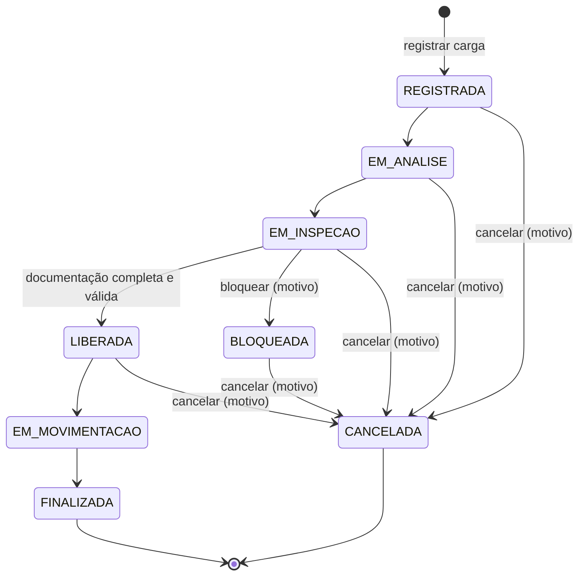

# Fluxo de status da carga química

Implementação: [`api/src/domain/value-objects/maquina-status-carga.ts`](../api/src/domain/value-objects/maquina-status-carga.ts) (tabela de transições) e [`CargaQuimica.alterarStatus()`](../api/src/domain/aggregates/carga-quimica.ts) (aplicação das regras).
A própria API serve essa tabela em `GET /meta/status-carga`.

## Diagrama

## Tabela de transições permitidas

| De \ Para | REGISTRADA | EM_ANALISE | EM_INSPECAO | LIBERADA | BLOQUEADA | EM_MOVIMENTACAO | FINALIZADA | CANCELADA |
|---|:-:|:-:|:-:|:-:|:-:|:-:|:-:|:-:|
| **REGISTRADA** | — | ✅ | ❌ | ❌ | ❌ | ❌ | ❌ | ✅ |
| **EM_ANALISE** | ❌ | — | ✅ | ❌ | ❌ | ❌ | ❌ | ✅ |
| **EM_INSPECAO** | ❌ | ❌ | — | ✅¹ | ✅² | ❌ | ❌ | ✅² |
| **LIBERADA** | ❌ | ❌ | ❌ | — | ❌ | ✅ | ❌ | ✅² |
| **BLOQUEADA** | ❌ | ❌ | ❌ | ❌ | — | ❌ | ❌ | ✅² |
| **EM_MOVIMENTACAO** | ❌ | ❌ | ❌ | ❌ | ❌ | — | ✅ | ❌ |
| **FINALIZADA** | ❌ | ❌ | ❌ | ❌ | ❌ | ❌ | — | ❌ |
| **CANCELADA** | ❌ | ❌ | ❌ | ❌ | ❌ | ❌ | ❌ | — |

¹ Exige documentação obrigatória completa e válida (`DOCUMENTACAO_INCOMPLETA`, HTTP 422).
² Exige `motivo` com ao menos 3 caracteres (`MOTIVO_OBRIGATORIO`, HTTP 422).

**Estados terminais:** `FINALIZADA` e `CANCELADA` não aceitam nenhuma nova alteração.

## Transições proibidas citadas na lauda

| Transição | Resposta da API |
|---|---|
| `CANCELADA → LIBERADA` | 409: *"Uma carga cancelada não pode ser liberada."* |
| `FINALIZADA → EM_MOVIMENTACAO` | 409: *"Carga com status Finalizada não pode sofrer novas alterações de status."* |
| `BLOQUEADA → EM_MOVIMENTACAO` | 409: *"Uma carga bloqueada não pode entrar em movimentação."* |
| `REGISTRADA → FINALIZADA` | 409: *"Transição de status não permitida: REGISTRADA → FINALIZADA."* |
| `EM_INSPECAO → FINALIZADA` | 409: *"Uma carga em inspeção não pode ser finalizada sem antes ser liberada."* |
| `LIBERADA → REGISTRADA` | 409: *"Transição de status não permitida: LIBERADA → REGISTRADA."* |

Toda transição recusada devolve `detalhes: { de, para }`. A carga e o histórico ficam inalterados.

## Como alterar o status pela API

| Endpoint | Efeito |
|---|---|
| `PATCH /cargas-quimicas/:id/status` `{ status, motivo? }` | Qualquer transição da tabela |
| `PATCH /cargas-quimicas/:id/liberar` | `→ LIBERADA` |
| `PATCH /cargas-quimicas/:id/bloquear` `{ motivo }` | `→ BLOQUEADA` |
| `PATCH /cargas-quimicas/:id/cancelar` `{ motivo }` | `→ CANCELADA` |

Os quatro endpoints usam o mesmo caso de uso (`AlterarStatusCarga`) e o mesmo método do agregado, então não existe caminho que pule uma regra. Toda resposta de carga traz `transicoesPermitidas`, que é a lista do que pode ser feito a partir do status atual. O painel web usa esse campo para montar o menu de ações.

## Ordem de validação dentro do agregado

1. O status de destino existe? Se não: `STATUS_INVALIDO` (422).
2. É o mesmo status atual? Se sim: 409.
3. Mensagens específicas das regras da lauda (cancelada → liberada, terminal, bloqueada → movimentação, inspeção → finalizada): 409.
4. A transição está na tabela? Se não: 409.
5. Indo para `LIBERADA`, a documentação está completa? Se não: 422.
6. Indo para `BLOQUEADA` ou `CANCELADA`, há motivo? Se não: 422.
7. Só então o status muda e uma entrada de histórico é criada.

## Diferença em relação à Fase 1

A Fase 1 previa `BLOQUEADA → EM_INSPECAO` ("reabrir para nova inspeção") e tratava `LIBERADA` como estado final. A lauda da Fase 2 define um fluxo mais longo, com `EM_ANALISE`, `EM_MOVIMENTACAO` e `FINALIZADA`, e só permite `BLOQUEADA → CANCELADA`. A implementação segue a Fase 2. A reabertura de carga bloqueada fica como evolução, quando houver a entidade Inspeção.
