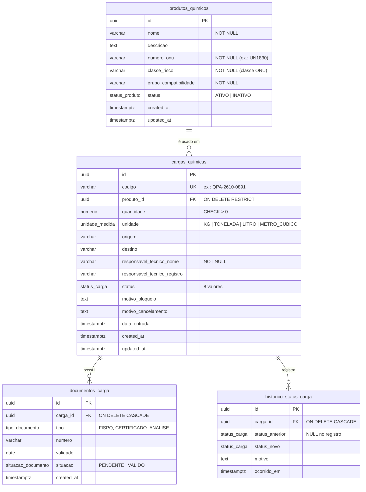

# Modelagem de dados

**Banco:** PostgreSQL 16 · **Acesso:** Drizzle ORM · **Schema:** [`api/src/infrastructure/persistence/schema.ts`](../api/src/infrastructure/persistence/schema.ts) · **Migrations:** [`api/drizzle/`](../api/drizzle)

## Por que um banco relacional

| Critério | Análise |
|---|---|
| **Tipo de dado** | Estruturado e previsível: os campos de produto e carga são fixos e definidos pela lauda |
| **Relacionamentos** | Carga → Produto (N:1), Carga → Documentos (1:N), Carga → Histórico (1:N). As consultas cruzam essas entidades o tempo todo (listar cargas com o nome do produto, pendências por carga) |
| **Integridade** | Regras críticas de segurança ganham uma segunda barreira no banco: FK impede carga com produto inexistente, `RESTRICT` impede apagar produto em uso, `CHECK` impede quantidade ≤ 0, `UNIQUE` impede código duplicado e `ENUM` impede status fora da lista |
| **Transações** | Mudar o status de uma carga grava a carga e o histórico juntos. Com ACID, ou grava tudo ou nada |
| **Evolução** | Inspeções, áreas de armazenamento, usuários e permissões, previstos para as próximas fases, também são entidades relacionadas. Vão virar novas tabelas com FK, sem migração de formato |

MongoDB funcionaria para a carga com documentos embutidos, mas perderíamos as garantias de integridade entre carga e produto, que são justamente o centro das regras de negócio.

## Diagrama entidade-relacionamento

## Tabelas

### `produtos_quimicos`: como os produtos são armazenados

| Campo | Tipo | Regras |
|---|---|---|
| `id` | `uuid` **PK** | Gerado pelo domínio (`crypto.randomUUID`), não pelo banco. Assim a entidade já nasce com identidade |
| `nome` | `varchar(150)` | Obrigatório |
| `descricao` | `text` | Opcional |
| `numero_onu` | `varchar(10)` | Normalizado para `UN` + 4 dígitos |
| `classe_risco` | `varchar(5)` | Classe/subclasse ONU validada pelo objeto de valor `ClasseRisco` (1–9 e subdivisões) |
| `grupo_compatibilidade` | `varchar(50)` | Obrigatório (ex.: `ACIDOS`, `INFLAMAVEIS`) |
| `status` | `enum status_produto` | `ATIVO` (padrão) ou `INATIVO` |
| `created_at` / `updated_at` | `timestamptz` | Auditoria |

Índices: `status` e `nome` (filtros da listagem).

**Inativação lógica:** produtos nunca são apagados. `PATCH /produtos-quimicos/:id/inativar` muda o status para `INATIVO`. O produto continua referenciado pelas cargas antigas, mas o agregado recusa registrar novas cargas com ele (`PRODUTO_INATIVO`).

### `cargas_quimicas`: como as cargas são armazenadas

| Campo | Tipo | Regras |
|---|---|---|
| `id` | `uuid` **PK** | Gerado no domínio |
| `codigo` | `varchar(30)` **UNIQUE** | Informado ou gerado (`QPA-AAMM-XXXX`) |
| `produto_id` | `uuid` **FK → produtos_quimicos.id** | `ON DELETE RESTRICT` |
| `quantidade` | `numeric(14,3)` | `CHECK (quantidade > 0)`. Usa `numeric` (e não `float`) para não perder precisão |
| `unidade` | `enum unidade_medida` | `KG`, `TONELADA`, `LITRO`, `METRO_CUBICO` |
| `origem` / `destino` | `varchar(150)` | Obrigatórios |
| `responsavel_tecnico_nome` / `_registro` | `varchar` | O nome é obrigatório. O responsável técnico é um objeto de valor embutido na carga |
| `status` | `enum status_carga` | Ver abaixo |
| `motivo_bloqueio` / `motivo_cancelamento` | `text` | Preenchidos ao bloquear ou cancelar |
| `data_entrada` | `timestamptz` | Data de entrada no porto |
| `created_at` / `updated_at` | `timestamptz` | Auditoria |

Índices: `status` (painel e filtros) e `produto_id` (filtro e FK).

### `documentos_carga`: documentação obrigatória

Cada linha é um documento exigido para a carga. Faz parte do agregado: só é alterada via `PATCH /cargas-quimicas/:id/documentos`, que substitui a lista inteira dentro da mesma transação.

Um documento conta como **entregue** quando `situacao = 'VALIDO'` **e** `validade` é nula ou ainda não passou. A carga só é liberada se tiver pelo menos um documento e todos estiverem entregues.

### `historico_status_carga`: auditoria das transições

Uma linha por mudança de status, inclusive o registro inicial (`status_anterior = NULL`, `status_novo = REGISTRADA`). É gravada **na mesma transação** que atualiza a carga, então nunca existe mudança de status sem histórico, nem histórico de uma mudança que não aconteceu.

Alimenta `GET /cargas-quimicas/:id/historico`, as "últimas movimentações" do `/resumo-operacional` e a linha do tempo do painel.

## Como uma carga se relaciona com um produto

- Relação **N:1** pela FK `cargas_quimicas.produto_id`.
- No domínio, a carga referencia o produto **por identidade** (`produtoId`), como definido na Fase 1: produto e carga têm ciclos de vida diferentes.
- Ao registrar, o caso de uso carrega o produto e o entrega ao agregado, que valida se ele existe e se está ativo.
- Nas leituras, a API devolve um resumo do produto (`id`, `nome`, `numeroOnu`, `classeRisco`) junto com a carga.

## Como o status da carga é controlado

1. **No banco:** o tipo `enum status_carga` aceita só os 8 valores válidos.
2. **No domínio:** a tabela `TRANSICOES_PERMITIDAS` ([`maquina-status-carga.ts`](../api/src/domain/value-objects/maquina-status-carga.ts)) é a única fonte da verdade. `CargaQuimica.alterarStatus()` verifica a transição, as regras dependentes de estado (documentação para liberar, motivo para bloquear ou cancelar) e só então muda o status e registra o histórico.
3. **Na persistência:** o repositório grava carga + documentos + histórico numa transação.

Detalhes em [`fluxo-status-carga.md`](fluxo-status-carga.md).

## Como os dados podem evoluir nas próximas fases

| Evolução | Mudança no modelo |
|---|---|
| **Inspeções** com resultado e laudo | Nova tabela `inspecoes (id, carga_id FK, resultado, inspetor, data)`; o status `EM_INSPECAO` passa a exigir uma inspeção aberta |
| **Responsável técnico** como cadastro próprio | Tabela `responsaveis_tecnicos` e troca das colunas `responsavel_tecnico_*` por `responsavel_tecnico_id FK` |
| **Áreas de armazenamento** e compatibilidade | Tabela `areas_armazenamento` + `cargas_quimicas.area_id FK`; regra de segregação usando `grupo_compatibilidade` |
| **Usuários e permissões** | Tabelas `usuarios` e `perfis`; o histórico ganha `usuario_id` (quem fez a transição) |
| **Anexos de documentos** | `documentos_carga.arquivo_url` apontando para storage de objetos (S3/MinIO) |
| **Volume alto de histórico** | Particionamento de `historico_status_carga` por mês |

Toda mudança entra como uma nova migration versionada em `api/drizzle/` (`npm run db:generate`), aplicada automaticamente quando a API sobe.
